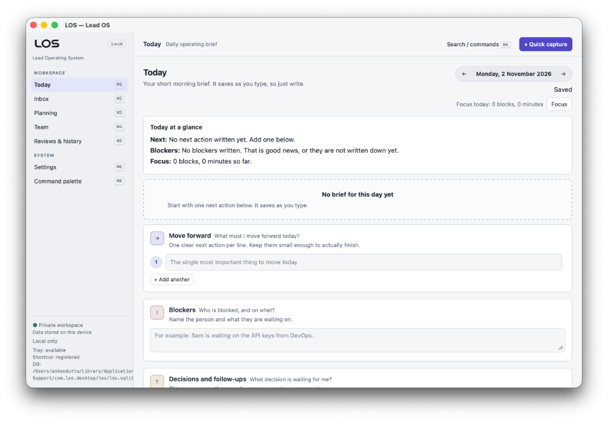
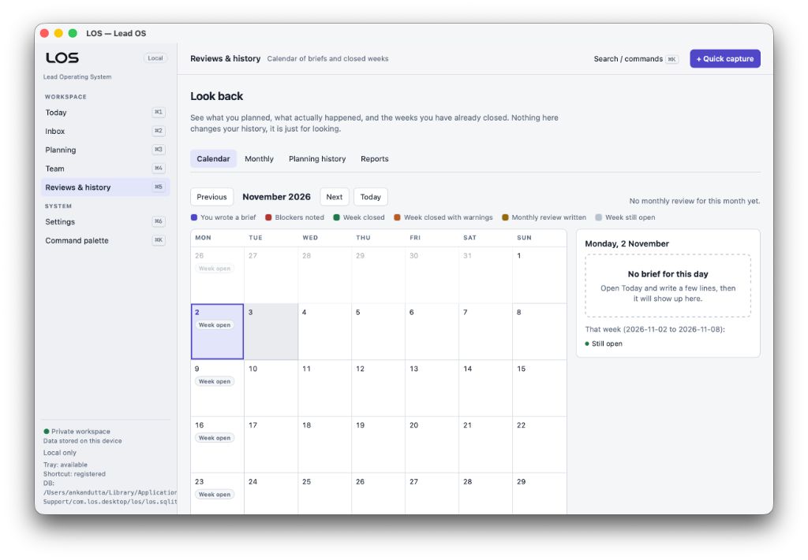

# LOS (Lead OS)

Local-first desktop workspace for engineering leads. Offline by default; no account, cloud, Jira, Confluence, or LLM required for the foundational workspace.

## Screenshots

### Today



### Reviews & history



## Releases

Download builds from the [GitHub Releases](https://github.com/ankan97dutta/los/releases) page. Prefer the latest tag (for example `v0.1.0`).

| Platform | File | Notes |
|----------|------|-------|
| macOS (Apple Silicon + Intel) | `LOS_<version>_universal.dmg` | Drag **LOS** into Applications |
| Windows (x64) | `LOS-<version>-windows-x64.exe` | Portable — run directly, no installer |

Older Windows `.msi` / `*-setup.exe` assets on a release may be leftovers from earlier builds. Use the portable `.exe` above.

Builds are not code-signed yet, so the OS will warn the first time you open them.

### macOS

1. Open the `.dmg` and drag **LOS** into **Applications**. Do not launch it from the disk image.
2. Open **LOS** from Applications. Gatekeeper may show **"LOS" Not Opened**.
3. Click **Done**, then open **System Settings → Privacy & Security**.
4. Under **Security**, choose **Open Anyway**, confirm, and launch LOS again.

If **Open Anyway** is missing, try opening the app once more from Applications, then return to Privacy & Security. As a last resort:

```bash
xattr -dr com.apple.quarantine /Applications/LOS.app
open /Applications/LOS.app
```

### Windows

1. Download `LOS-<version>-windows-x64.exe` and run it.
2. If **Windows protected your PC** (SmartScreen) appears, click **More info**, then **Run anyway**.
3. If there is no **More info**, right-click the file → **Properties** → check **Unblock** → **OK**, then run it again.

Windows needs the [WebView2 Runtime](https://developer.microsoft.com/microsoft-edge/webview2/). Windows 11 includes it; Windows 10 usually has it if Edge is installed.

Data still lives under the normal app-data folder (not next to the `.exe`). See [Database location](#database-location).

## Packages

| Package | Role |
|---------|------|
| `packages/domain` | Pure TypeScript domain rules (no UI/DB) |
| `packages/persistence` | SQLite migrations + `DbSession` adapters (`better-sqlite3` Node; shared repos) |
| `packages/app-services` | Command/query orchestration |
| `apps/desktop` | Tauri 2 + React UI (macOS-first) |

## Develop

```bash
export PATH="$HOME/.local/bin:$PATH"   # if pnpm installed to ~/.local
pnpm install
pnpm test
pnpm lint
pnpm --filter @los/desktop dev        # Vite preview (non-durable localStorage)
pnpm --filter @los/desktop tauri:dev  # durable SQLite + tray + global shortcut
```

## Database location

| Runtime | Path |
|---------|------|
| Vite preview | `localStorage` key `los-db-v1` — **non-durable**; not SC-H01 |
| Node / Vitest | temp or helper paths via `better-sqlite3` |
| Tauri-dev / packaged | `$APP_DATA/los/los.sqlite` (macOS: under Application Support for the app id) |

**Single-writer**: one app instance per DB file. Do not run two writers against the same file. Locked/corrupt open fails with `DB_OPEN_FAILED` and leaves file bytes unchanged (no silent reseed).

Backup: Settings → Export (SQLite copy), or copy `los.sqlite` while quit. Restore: Settings → Restore, or quit-and-replace the file then relaunch. Automated: `pnpm --filter @los/persistence test`.

## Spec Kit

Active feature: `specs/003-fortnight-capacity/` (capacity planning). Baselines: `specs/001-foundation-workspace/`, `specs/002-harden-foundation/`.
